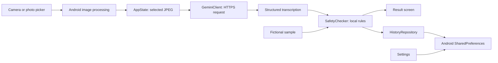

# Architecture



1. `MainActivity` initializes the Compose UI; `ScriptDoctorApp` initializes the application context used by Android storage.
2. `App` creates `AppState`, which holds observable UI state, navigation, a coroutine job, the repository, and the Gemini client. `AppHost` renders Scan, History, Settings, or Result. Android back navigation returns a result to its originating tab.
3. `rememberImagePicker` delegates to Android's photo picker or `TakePicture` contract. The camera receives a `FileProvider` URI for `cache/captures/capture.jpg`. Image processing occurs on `Dispatchers.IO`: bounds are read, the bitmap is subsampled, EXIF rotations of 90, 180, and 270 degrees are applied, the long edge is limited to 1,568 pixels, and the result is encoded as JPEG at quality 88.
4. On Decode, `AppState` launches a coroutine. `GeminiClient` obtains the saved key, sends the JPEG, and parses the structured response. While decoding, the app exposes cancellation. Failures are surfaced in a snackbar.
5. `SafetyChecker.check` analyzes the returned transcription. `overallRisk` picks the highest local flag severity, or LOW if there are no flags. `AppState` creates a result with a random ID, timestamp, model, flags, and risk, then displays it and saves non-sample results.

## Project layout

```text
.
├── composeApp/
│   ├── build.gradle.kts              Android and Kotlin configuration
│   └── src/
│       ├── commonMain/kotlin/com/scriptdoctor/
│       │   ├── App.kt                theme, scaffold, navigation rendering
│       │   ├── AppState.kt           state, decode lifecycle, navigation, history
│       │   ├── SampleData.kt         fictional demonstration transcription
│       │   ├── api/GeminiClient.kt   HTTP client, prompts, response schema
│       │   ├── data/HistoryRepository.kt
│       │   ├── model/Prescription.kt data models
│       │   ├── platform/Platform.kt  expected platform interfaces
│       │   ├── safety/SafetyChecker.kt
│       │   └── ui/                   Scan, Result, History, Settings screens
│       ├── androidMain/              Android activity, storage, image handling, manifest, resources
│       └── commonTest/               Gemini client and safety-rule unit tests
├── .github/workflows/                CI and release workflows
├── gradle/                           version catalog and wrapper
├── release/ScriptDoctor.apk          included APK artifact
├── docs/                             project documentation
├── README.md
└── LICENSE                           MIT
```

## Data structures


| Object | Fields |
| --- | --- |
| `Transcription` | `is_prescription`, `legibility` (`clear`, `partially_legible`, `illegible`), `patient_name`, `prescriber_name`, `date`, `medications`, `general_notes` |
| `Medication` | `raw_text`, `drug_name`, `strength`, `dosage_form`, `route`, `frequency`, `duration`, `quantity`, `instructions_plain`, `confidence` (`high`, `medium`, `low`), `alternative_readings`, `concerns` |
| `SafetyFlag` | Kind, severity, message, and medication index; index `-1` means a document-level flag |
| `DecodeResult` | ID, creation time in epoch milliseconds, transcription, flags, overall risk, model, and sample indicator |

Model concerns and general notes are displayed, but they do **not** directly determine the overall risk. Risk is calculated from the local flags only.

[Back to README](../README.md)

